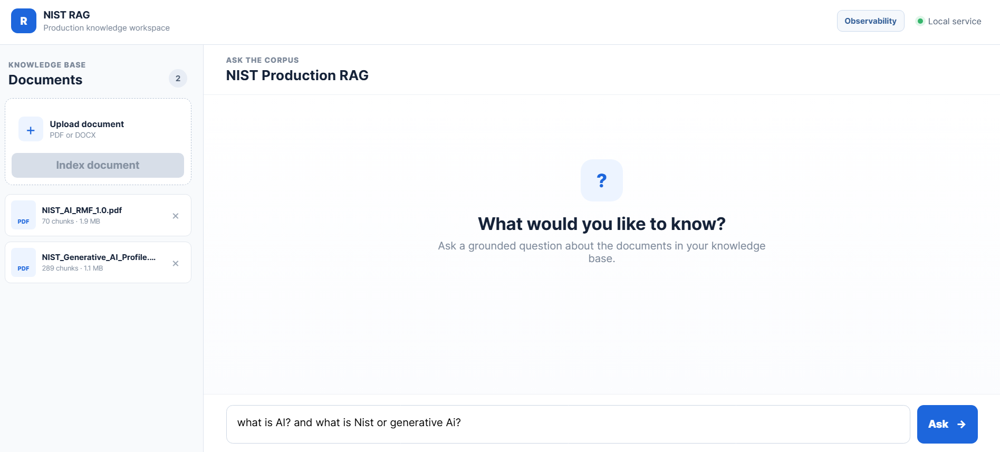

# Screenshot gallery

This gallery catalogs the screenshots currently stored in this folder. Select
an image to open its full-size version. Captures show different iterations of
the app: some are older layouts and show only PDF/DOCX support. Use the running
application and [main setup guide](../../README.md) as the source of truth for
current behavior.

Before sharing screenshots publicly, check that they do not reveal real
credentials, private document content, or personal information. These images
are visual references and are not, on their own, evidence of a current
deployment or independently verified behavior.

Static screenshots do not demonstrate edge-case handling. Use the
[edge-case demo checklist](../EDGE_CASES.md) to record the actual interactions
for a video; this repository does not include that recording.

## Sign in and account creation

| Screen | Description |
|---|---|
| [Sign in](#sign-in) | Sign-in form in the account screen. |
| [Create account](#create-account) | Account creation form with the password length hint. |

### Sign in

### Create account

## Browser workspace

| Image | What it shows |
|---|---|
| [Updated workspace](#updated-workspace) | Document list, upload panel, and question composer. |
| [Grounded response with passages](#grounded-response-with-retrieved-passages) | Answer, source citation, and expanded retrieved passages. |
| [Response and citation view](#response-and-citation-view) | Earlier response layout with citations and retrieved chunks. |
| [Legacy RAG results view](#legacy-rag-results-view) | Earlier, narrow-screen app view with a response and ranked chunks. |
| [Observability dashboard](#observability-dashboard) | Request metrics and recent request traces. |

### Updated workspace

### Grounded response with retrieved passages

### Response and citation view

### Legacy RAG results view

This is a narrow, older UI capture; its visual layout and supported-format
label may not match the current frontend.

### Observability dashboard

## API documentation

### Swagger UI

The Swagger capture is a long, older API-docs screenshot. It illustrates the
interactive API layout; use `/docs` on a running service for the current route
list, schemas, and responses.

